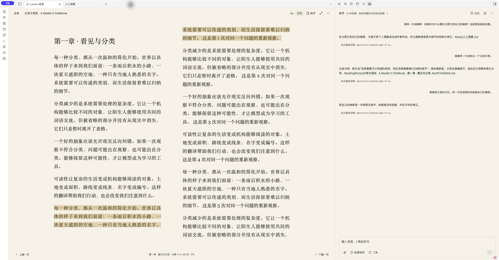

# Lumen 5.10.0 — Antigravity 对话与生图 / Antigravity chat and native images

[中文](#中文) · [English](#english) · [下载 / Download](https://github.com/leoyang1984/lumen-public/releases/tag/v5.10.0) · [完整指南 / Guide](docs/READING_GUIDE.md)

Lumen 在 Obsidian 中提供 EPUB 阅读、整书 AI 翻译、AI 对话、笔记整理和白板工作流。你可以使用 API，也可以调用电脑上已安装的 Codex、pi 或 Antigravity（agy），不需要一直打开终端窗口。

Lumen brings EPUB reading, full-book AI translation, AI chat, note organization and Canvas workflows into Obsidian. Use an API provider or an installed local Codex, pi or Antigravity (agy) CLI without keeping a terminal window open.

*Lumen 实际界面：双栏阅读、划线与右侧助手，统一纸色和对齐的简洁顶栏。书籍与对话来自原创测试材料；右侧展示已恢复的历史对话。 / Actual Lumen interface: two-column reading, highlights and a companion panel, with a shared paper background and aligned, minimal toolbars. The book and conversation use original test material; the panel shows restored chat history.*

## 中文

### 5.10.0 更新了什么？

**新增本机 Antigravity 对话与原生生图。** 在“连接”中选择已安装并登录的 `agy`，可讨论笔记和 EPUB 选文、连续追问、检索笔记、确认修改与撤销，并使用该连接翻译 EPUB。

- **原生文生图**：在“助手能力”开启“Antigravity 生图”（默认关闭），从对话工具菜单选择“生成配图”，或明确输入“生成一张图片……”。图片先预览，确认后保存 PNG 附件和说明笔记，不回退到 API。
- **生图后继续聊**：生图使用独立的一次性进程，普通对话连接和上下文保留。图片完成、失败或取消后可直接追问，不再错误显示断开。
- **开关名称清楚**：选择 Antigravity 时显示“Antigravity 生图”，选择 Codex 时显示“Codex 生图”；生成权限仅作用于明确请求的当前消息。
- **CLI 兼容性修复**：包含 5.9.1 对新版 Codex/pi 的兼容修正，按所需协议能力检查连接，不再锁定精确版本号。
- **阅读与翻译保留**：整书／章节翻译、术语表、双语对照和标准 EPUB 导出继续可用。

[Antigravity 设置与范围](docs/ANTIGRAVITY_GUIDE.md) · [5.10.0 更新说明](docs/RELEASE_NOTES_5.10.0.md)

### 保留的 5.9.0 翻译功能

**整书 AI 翻译，标准 EPUB 导出。** 在阅读器中直接针对当前 EPUB 书籍创建翻译任务，支持整书或自定义章节范围、翻译风格和专属术语表，并将翻译成果一键打包导出为标准 EPUB 电子书。

- **整书与章节翻译**：阅读器直接发起全书或选定章节的 AI 翻译任务，草稿分段独立落盘，支持随时暂停、断点无损续翻。
- **空章节智能跳过**：无文字内容的章节（如纯图片插画页、特殊版权页）自动标记为 `skipped` 并继续，杜绝整书翻译因空章节抛错中断。
- **多段合批降级与退避重试**：多段打包翻译若遇到超长段落或模型格式异常，自动拆解降级为单段请求，配合同段重试，彻底解决长难段落卡住死锁。
- **全结构自适应宽容 JSON 解析**：三级容错提取器，全面兼容顶层数组、单数对象、缺失 ID 单段保护、未转义引号正则修复及纯文本兜底。
- **EPUB 电子书导出**：支持“仅中文译稿”与“双语对照”两种排版模式，自动处理伪图片引用，支持非关键资源缺失优雅降级。
- **延续安静阅读体验**：保留 5.8.10 的书页与助手统一纸色、Aa 排版集中调节、专注阅读、跨章连续翻页与白板工作流。

### 保存位置（延续 5.8.5）

**保存在哪里，由你决定。** 在“设置 → Lumen → 阅读与保存 → 保存位置”集中设置书籍、笔记、图片和对话的目录。默认设置可以直接使用，也可以选择已有文件夹、填写新文件夹，或明确选择笔记库根目录。

- 所有路径相对于当前笔记库。例如笔记库叫 A，填写 `B/笔记`，文件就保存到 A 内的 B/笔记；无需填写电脑绝对路径。
- 点击“应用”才生效；每项可恢复默认。新文件夹在实际保存时创建。空的自定义目录、越界路径、内部目录及文件冲突会提示错误。
- 修改位置只影响新文件，不搬动已有书籍、笔记或图片。旧 API 图片目录继续沿用，旧文件与原文回跳保持原记录。
- 保存确认显示目标位置；全局设置变化不会改变已打开确认窗口的目标。失败保留草稿或预览，不覆盖同名文件。
- 阅读笔记可单次另选目录或追加已有笔记；对话导出默认集中到 `Reading/Conversations`，旧导出保持原样。

| 保存内容 | 默认目录 |
| --- | --- |
| 导入 EPUB | `Reading/Books` |
| 阅读笔记与确认想法 | `Reading/Notes` |
| Codex / Antigravity 原生图片 | `attachments/lumen-generated` |
| 图片说明笔记 | `Reading/Images` |
| 粘贴／上传图片 | `attachments/lumen-input-images` |
| API 图片 | `attachments/ai-gen` |
| 导出对话 | `Reading/Conversations` |

图片说明笔记、上传图片和 API 图片目录在“高级保存位置”中展开。内部历史、缓存、阅读关联和撤销数据的位置固定。详见[保存位置指南](docs/READING_GUIDE.md)。

### 延续的界面与交互改进

- **更自然的对话界面**：输入框底部只有一排操作；联网直接可见，生图、Skill 和扩展放入工具菜单。历史、新对话、更多操作分清用途；诊断日志不再混在历史旁边。
- **联网开一次，连续使用**：设置和输入框控制同一个开关。发送、追问、新对话和重启后仍保留，直到自行关闭。开启表示允许按需搜索，不强制每次搜索；生图仍需明确要求，Skill 和扩展的显式选择仍按消息使用。
- **设置按任务分组**：连接、助手能力、API 服务、阅读与保存、白板与自动化、高级与诊断、关于，每次只显示一组。
- **API 配置集中管理**：文字模型、图片识别、API 生图默认折叠，显示已配置／未配置／未启用。“已配置”表示必要字段已填写，不代表连接测试成功。
- **阅读与保存更清楚**：展开查看正在讨论的选文；区分原话和 AI 草稿；保存前可编辑并查看目标位置。已保存结果直接打开笔记，避免重复保存；无法发送时保留输入并提供解决入口。
- **无需订阅或激活码**：取消员工数量和付费功能门槛。模型费用由你的服务商或 CLI 账号决定；预算、文件权限、写入预览确认和撤销仍保留。

### 可以做什么？

| 场景 | 功能 |
| --- | --- |
| 读电子书 | 无 DRM、可重排 EPUB；目录、单／双栏、主题与排版、专注模式、方向键、跨章连续翻页、阅读位置恢复 |
| 边读边聊 | API / Codex / pi / Antigravity 对话、连续追问、人工笔记检索、带出处的笔记与原文回跳 |
| 使用本机能力 | Codex 搜索、可信独立指令型 Skill、兼容 Pi 工具扩展、明确请求的 Codex / Antigravity 原生生图 |
| 整理笔记 | 原话保存、AI 草稿编辑确认、历史与导出、受控修改与撤销 |
| 白板思考 | Canvas 算子与连线、文字／图片工作流、API 图片生成和编辑 |
| 自动任务 | 员工定义、技能与知识边界、手动／文件监控／定时触发、预算及运行记录 |

CLI 对话不需要额外配置 MCP。白板、员工等原有 API 功能仍使用“API 服务”中的模型配置，并不会自动改用 CLI。

### 安装和升级

**BRAT**：安装 Obsidian 42 - BRAT → Add Beta plugin → 输入 `leoyang1984/lumen-public` → 启用 Lumen。已有用户在 BRAT 中检查更新。

**手动安装**：从 [5.10.0 Release](https://github.com/leoyang1984/lumen-public/releases/tag/v5.10.0) 下载三个运行文件，将 `main.js`、`manifest.json`、`styles.css` 放入笔记库的 `.obsidian/plugins/lumen/`，然后启用插件。指南与第三方声明放在本仓库文档中，无需复制到插件目录。

**升级先备份，只替换三个运行文件**。保留 `data.json`、阅读状态和历史，重载 Lumen 或重开 Obsidian。从 5.8.4 之前的版本首次升级时，所有已有自主员工（包括此前正在使用的员工）会保持暂停；请在“白板与自动化”检查配置并逐个确认恢复，避免取消授权后突然开始任务。新员工默认关闭自主工作。

### 条件与已知范围

- 本轮 42 个自动测试文件、类型检查与生产构建通过。macOS 本机 agy 实测覆盖问答、受控读取、1024×1024 生图、停止恢复及“生图后直接追问”；Chromium 验证 JPEG 转 PNG 预览。
- Antigravity 的原生联网、Skill、扩展与图片输入暂未接通；本次支持文生图，不支持参考图编辑。

- EPUB 可离线阅读；AI 需要 API 配置，或已安装、配置并登录的 Codex CLI / pi / Antigravity（agy）。CLI 原生能力需要桌面 Obsidian，并要求模型与账号支持相应能力。
- 前序实测环境：macOS、Obsidian 1.14.4、Codex CLI 0.160.1、pi 1.1.0。这些是验证记录，不是强制锁定版本。其他系统、实体移动设备和所有服务商组合未完整实测。
- Codex 搜索需要联网。Pi 搜索还需要自行安装、选中并启用兼容的搜索扩展；Lumen 不内置通用 Pi 搜索扩展，第三方推荐与兼容性评估仍待完成。
- Pi 扩展运行可信本机代码，不是沙箱；扩展自己写文件不保证经过 Lumen 笔记确认。复杂 Skill、纯终端交互扩展和任意扩展不保证兼容。
- 原生 Codex / Antigravity 图片支持文生图并保存为 PNG，不含参考图编辑；API 图片生成／编辑是独立功能。未发送输入不保证跨插件重载恢复。
- 5.8.5 已通过 36 个自动回归入口、10 项本机协议测试、类型检查、生产构建和打包。独立 macOS 测试库走通保存位置配置与恢复、原创 EPUB 导入、原话保存、真实 Pi 回答确认、对话导出和引用回跳。API 图片路由与原生 PNG 存储使用原创模拟数据；本轮未覆盖所有真实生图服务、其他系统及自主任务升级迁移。

[中英文更新说明](docs/RELEASE_NOTES_5.10.0.md) · [使用指南](docs/READING_GUIDE.md) · [运行时工作流教程](runtime-workflow-pack/) · [分发协议](COMMERCIAL_LICENSE.md) · [第三方声明](docs/THIRD_PARTY_NOTICES.txt)

## English

### What changed in 5.10.0?

**Local Antigravity chat and native image generation.** Select an installed, authenticated `agy` under Connection for notes and EPUB passages, followups, governed retrieval, confirmed note changes and undo, and EPUB translation.

- **Native text-to-image**: enable Antigravity image generation under Assistant capabilities (off by default), choose Generate an image in Tools or make an explicit image request. Review privately, then confirm to save a PNG attachment and note. No API fallback.
- **Continue chatting after images**: one-use image workers preserve the ordinary chat connection and context. Completion, failure and cancellation no longer incorrectly disconnect chat.
- **Clear image controls**: the switch names the selected assistant, Codex or Antigravity. Image permission applies only to a fresh explicit request.
- **CLI compatibility**: includes the 5.9.1 fix for updated Codex/pi CLIs. Connections check required protocol capabilities rather than exact version numbers.
- **Reading and translation retained**: whole-book/chapter translation, glossaries, aligned bilingual reading and standard EPUB export remain available.

[Antigravity setup and limits](docs/ANTIGRAVITY_GUIDE.md) · [5.10.0 release notes](docs/RELEASE_NOTES_5.10.0.md)

### Retained 5.9.0 translation features

**Full-book AI translation and standard EPUB export.** Translate entire EPUB books or custom chapter ranges directly from the reader with custom styles and glossaries, and export completed drafts into standard EPUB publications.

- **Book and chapter translation**: launch translation tasks for whole books or selected chapters directly inside the reader. Drafts are safely persisted passage by passage with pause and breakpoint resumption.
- **Empty chapter skip**: non-text chapters (e.g. image-only plates, copyright pages) are automatically skipped without interrupting translation progress.
- **Batch fallback and retries**: batch translations automatically degrade to single-unit requests upon encountering extra-long passages or formatting anomalies, paired with exponential backoff retries.
- **Resilient JSON parsing**: multi-tier parser supporting top-level arrays, singular objects, single-unit ID tolerance, unescaped quote repair, and prose fallbacks.
- **Standard EPUB export**: export "Chinese Translation Only" and "Bilingual Aligned" EPUB publications with sanitized citation links and graceful image fallbacks.
- **Quiet reading retained**: retains unified paper backgrounds, typography controls, focus mode, continuous cross-chapter paging, and Canvas workflows from 5.8.10.

### Save locations (retained from 5.8.5)

**Choose where your files go.** Seven save locations are grouped under **Settings → Lumen → Reading and saving → Save locations**. Defaults work without setup. Pick an existing folder, type a new folder, or explicitly choose Vault root.

- Paths are relative to your current Vault: `B/Notes` means that folder inside the Vault, not an absolute computer path.
- Choose a mode and click **Apply**. Reset each location independently. Folders are created on actual saves. Empty custom paths, paths outside the Vault, internal folders and file conflicts are reported.
- Changes affect new files only. Existing books, notes and images keep their locations and source links. Existing API image folders are retained.
- Save confirmations show their destination and retain it even if global settings change. Failed saves keep drafts/previews; filename conflicts never overwrite existing files.
- Reading notes can choose a different folder for one save or append to a note. Conversation exports default to `Reading/Conversations`; old exports remain in place.

| Content | Default folder |
| --- | --- |
| Imported EPUBs | `Reading/Books` |
| Reading notes and confirmed ideas | `Reading/Notes` |
| Native Codex / Antigravity images | `attachments/lumen-generated` |
| Image notes | `Reading/Images` |
| Pasted/uploaded images | `attachments/lumen-input-images` |
| API images | `attachments/ai-gen` |
| Conversation exports | `Reading/Conversations` |

Image notes, uploads and API images are under **Advanced locations**. Internal history, caches, reading metadata and undo storage remain fixed. See the [save locations guide](docs/READING_GUIDE.md).

### Existing UI and interaction improvements

- **A clearer chat layout**: one composer toolbar. Search stays visible; images, Skills and extensions use the tools menu. History, new chat and more actions have distinct roles. Diagnostic logs are separate from conversation history.
- **Persistent search permission**: settings and the composer share one switch. It survives messages, follow-ups, new conversations and reopening until you turn it off. Search is available as needed, not mandatory for every answer. Images need explicit requests; explicit Skill and extension selections remain per-message.
- **Settings by task**: Connection, Assistant capabilities, API services, Reading and saving, Canvas and automation, Advanced and diagnostics, and About. Only one group is shown at a time.
- **API services together**: collapsed text, image-understanding and API image sections show configuration state. “Configured” means required fields are filled, not that a connection test passed.
- **Clear reading and saving**: inspect the pinned passage, distinguish your words from AI drafts, edit before saving, and see the destination. Saved results open their existing note. Blocked sends keep your input and offer a next action.
- **No subscription activation**: no activation code or paid/count gate for employees. Provider/CLI charges, budgets, file permissions, write confirmation and undo still apply.

### Main features

Read DRM-free reflowable EPUBs with contents, single/two columns, themes, typography, focus mode, continuous chapter paging, keyboard navigation and restored positions. Discuss passages through API/Codex/pi/Antigravity, retrieve human notes, confirm source-linked Markdown and return to the passage. Use Codex search, trusted self-contained instruction Skills, compatible Pi tool extensions and explicitly requested native Codex/Antigravity images. Canvas operators support visual text/image workflows; employees support bounded knowledge, triggers, budgets and run records.

CLI chat does not require extra MCP setup. Existing Canvas and employee API features keep using API services; they do not automatically switch to a CLI.

### Install and upgrade

**BRAT**: install Obsidian 42 - BRAT, choose Add Beta plugin, enter `leoyang1984/lumen-public`, then enable Lumen. Existing BRAT users can check for updates.

**Manual**: download the [5.10.0 release](https://github.com/leoyang1984/lumen-public/releases/tag/v5.10.0). Copy only `main.js`, `manifest.json`, `styles.css` into `.obsidian/plugins/lumen/` in your Vault and enable the plugin. The guide and third-party notices are in this repository; they are not installation files.

Back up first. Replace only the three runtime files; keep settings, reading state and history. Reload Lumen or reopen Obsidian. All existing autonomous employees, including previously active ones, stay paused when first upgrading from a version before 5.8.4. Review and confirm them under Canvas and automation before resuming. New employees retain opt-in autonomy.

### Requirements and limits

This update passed 42 automated test files, TypeScript and production build. Live macOS agy checks covered chat, governed reads, a 1024×1024 image, stop/recovery and direct followups after generation. Chromium verified JPEG-to-PNG previews. Antigravity native web search, Skills, extensions and image input are unavailable; the integration supports text-to-image, not reference-image edits.

Reading works offline. AI needs a configured API or installed/configured/signed-in Codex CLI/pi/Antigravity (agy). Native CLI capabilities require desktop Obsidian and a suitable model/account. Earlier acceptance used macOS, Obsidian 1.14.4, Codex CLI 0.160.1 and pi 1.1.0; these are tested versions, not exact version locks. Other OS/device/provider combinations are not fully verified.

Pi web search needs an installed, selected and enabled compatible extension. Lumen does not bundle a general Pi search provider; third-party recommendations remain pending. Extensions run trusted local code, not a sandbox; their direct writes can bypass Lumen note confirmation. Complex Skills and terminal-only or arbitrary extensions are not guaranteed. Native Codex / Antigravity images currently support PNG generation, not native editing; API image generation/editing is separate. Unsent input may not survive reload.

5.8.5 passed 36 regression entry points, 10 local-agent protocol tests, TypeScript, production build and packaging. An isolated macOS Vault covered save settings and reload, original EPUB import, your words, a live Pi answer, confirmed notes, export and source return. API image routes and native PNG storage used original deterministic fixtures. All live image providers, other platforms and autonomous-task upgrade migration are outside this verification.

[Release notes](docs/RELEASE_NOTES_5.10.0.md) · [Guide](docs/READING_GUIDE.md) · [Workflow tutorials](runtime-workflow-pack/) · [Distribution terms](COMMERCIAL_LICENSE.md) · [Third-party notices](docs/THIRD_PARTY_NOTICES.txt)
