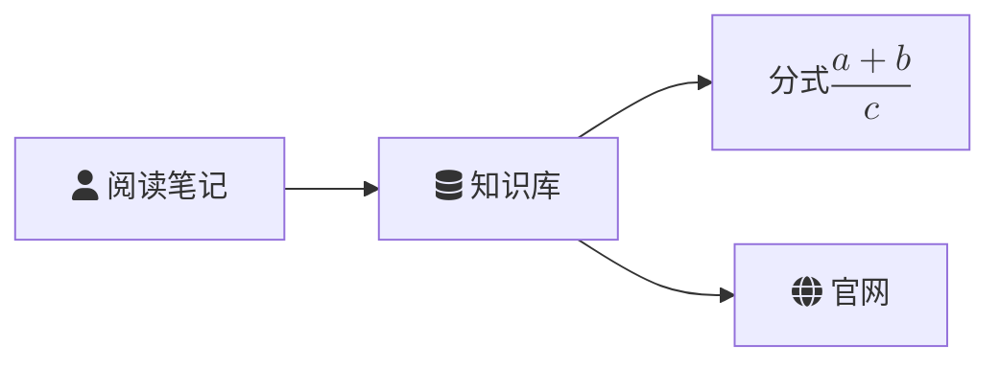
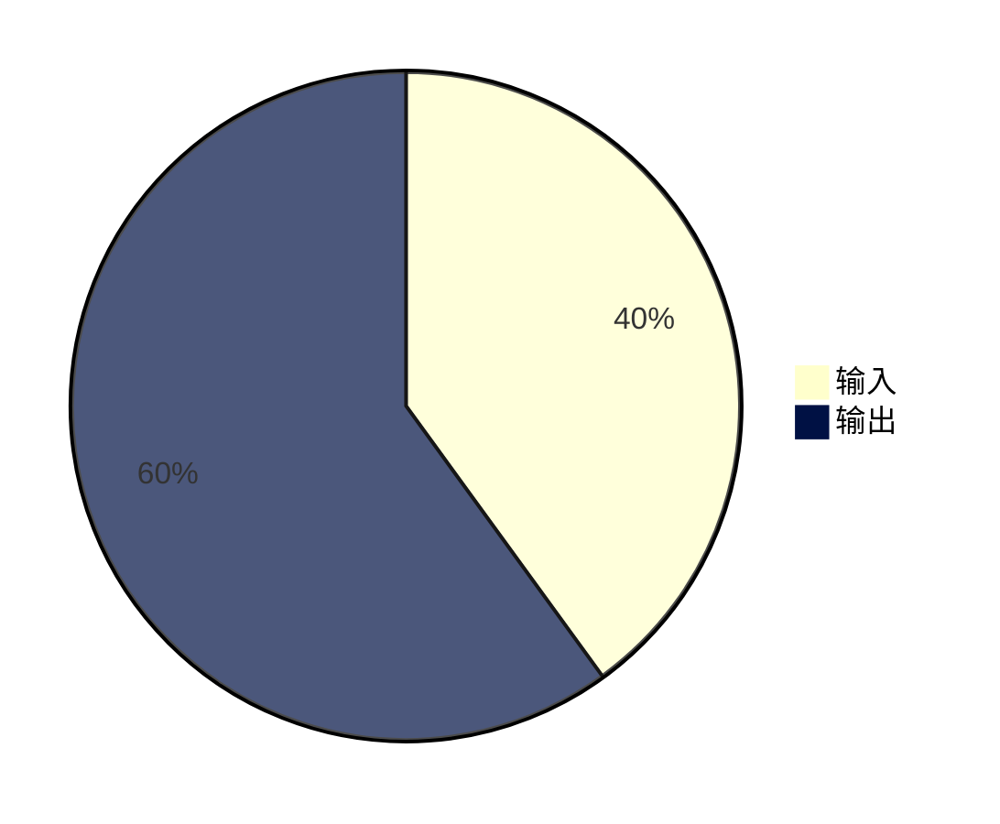

# 图表使用指南 / Diagram Guide

适用版本 / Version: **LUMEN 5.15.1**, Obsidian **1.5.7+**. Renderer: **Pele 1.13.0**.

## 中文

让助手输出独立的 `mermaid` 代码块。图表右上角的「⋯」提供源码切换、文本复制、图片复制、保存到笔记、SVG 导出及图表设置。

### 公式、图标和链接

为笔记节点添加 `click A "Folder/Existing Note.md"`，将示例路径替换为真实的完整库内路径。缺失文件或同名歧义只显示提示，不创建笔记。`[[双链]]` 写在节点标签里不会自动建立导航。只开放 Markdown 笔记和 HTTP/HTTPS 网页；拖动和缩放不会触发节点跳转。

公式用一对 `$$` 包裹，单个 `$` 不作为图表公式定界符。支持常用 TeX/AMS 数学表达式；单公式最长 2,000 字符。语法错误或不支持的命令回退为源码。适用位置取决于 Pele 的图表类型及标签支持；类成员和图表标题仍按文本处理。不编译任意 LaTeX 文档或动态加载宏包。

流程图的 `fa:fa-` 是 Mermaid 语法别名，实际使用离线 Lucide 图形。架构图示例：

可用图标名见下方共用清单。未知名称保留可读标签；不假定所有图表都支持同一种图标语法。

### 设置与导出

在「⋯ → 图表设置…」或「设置 → LUMEN → 高级与诊断」选择：

| 设置 | 可选值 | 默认 |
| --- | --- | --- |
| 布局方向 | 自适应、保持源码方向 | 自适应 |
| 基础字号 | 小 14 px、标准 16 px、大 20 px | 标准 |
| 最大缩放 | 3×、5×、8×，相对自然尺寸 | 3× |
| 图表主题 | Auto、Paper | Auto |
| 技术标签使用等宽字体 | 开启、关闭 | 关闭 |

设置作用于所有 LUMEN 图表，保存成功后更新已有图表。布局／字号／缩放上限变化可能恢复适配视图。窄栏中的宽图仍可能缩小，可配合缩放阅读。普通滚轮滚动聊天，Ctrl/⌘＋滚轮或双指用于缩放，放大后可拖动。

开启「技术标签使用等宽字体」后，类图属性与方法、ER 图字段、目录树文件与目录名使用 Obsidian 编辑器的等宽字体，按实际字体测量布局并保留到导出。时序图消息继续使用普通字体；源码明确设置的字体仍优先。旧设置默认关闭。

### 源码配色

未指定配色时继续遵循 Auto/Paper。可在 Mermaid 代码块内部使用 YAML frontmatter 指定系列颜色，例如：

支持 `pie1–pie8`、`git0–git7`、时间轴／雷达图／矩形树图的 `cScale0–cScale7`、思维导图的 `cScale1–cScale8`、`venn1–venn8`，以及 `xyChart.plotColorPalette` 的前八种颜色。非所有 Mermaid 主题变量都受支持。源码指定的固定颜色优先于主题，不随深浅色切换；未指定或无效颜色回退到主题。需要跟随主题时可使用 `var(--pele-accent)` 等 `--pele-*` 变量。自定义底色上的标签会尽可能选择对比色；明确指定的文字颜色仍由源码决定。

PNG 和独立 SVG 保留完整图表、图标、公式及当前配色。先打开 Markdown 笔记再选择「保存到笔记」；生成期间改变目标、光标或内容会阻止过期插入。SVG 去除活动导航和外部引用；PNG 是静态图片。[详细导出规则](DIAGRAM_EXPORT_GUIDE.md)。

## English

Ask the assistant for a standalone `mermaid` fence. The top-right ellipsis offers source view, Mermaid/Markdown copying, PNG copying, Save to note, SVG export and Diagram settings.

The examples above demonstrate offline icons and a fraction. Use `click A "Folder/Existing Note.md"` with an existing full Vault path for note navigation, or `click D "https://obsidian.md"` for a website. Missing/ambiguous notes report a message without creating a file. Wikilinks inside labels do not establish navigation. Only Markdown notes and HTTP/HTTPS websites are enabled; panning and zooming do not activate links.

Use paired `$$` delimiters for common TeX/AMS expressions; single `$` is not a diagram math delimiter. Each formula is limited to 2,000 characters. Invalid/unsupported expressions remain source. Support depends on diagram type and label position; class members and diagram titles remain text. Arbitrary LaTeX documents and dynamically loaded packages are not supported.

Flowchart `fa:fa-` names are Mermaid syntax aliases rendering bundled Lucide artwork, not Font Awesome. Architecture services use names such as `lumen:database`. Unknown icons retain readable labels; icon syntax is not universal across diagram types.

Under **ellipsis → Diagram settings…**, or **Settings → LUMEN → Advanced and diagnostics**, choose adaptive/source direction, 14/16/20 px base size, 3×/5×/8× maximum zoom and Auto/Paper. Defaults are adaptive, 16 px, 3× and Auto. Preferences apply to all LUMEN diagrams after saving and survive reload. Layout/font/zoom changes may reset the fitted view. A wide diagram can still appear small in a narrow pane; zoom to read it. The ordinary wheel scrolls chat; Ctrl/⌘+wheel or pinch zooms, and dragging pans an enlarged diagram.

**Monospace technical labels** is off by default, including for existing settings. Enable it to measure and draw class members, ER attributes and file/directory names using the editor's monospace font, including exports. Sequence messages keep their regular font; explicit source fonts remain authoritative.

**Source palettes:** the Mermaid frontmatter example above overrides the host palette. Supported series variables are `pie1–pie8`, `git0–git7`, `cScale0–cScale7` for timelines/radar/treemaps, `cScale1–cScale8` for mindmaps, `venn1–venn8`, and the first eight colors in `xyChart.plotColorPalette`. Other Mermaid theme colors may not apply. Explicit fixed colors do not change with the host theme; omitted/invalid entries use the host palette. Use `--pele-*` variables such as `var(--pele-accent)` to follow the theme. Labels on supported fills choose contrasting text unless the source specifies its own text color.

PNG and standalone SVG retain the full chart, icons, formulas and palette. Open a Markdown note before Save to note. Changes to the target note, cursor or content during export invalidate insertion. Exported SVG removes active navigation and external references; PNG is static. [Detailed export rules](DIAGRAM_EXPORT_GUIDE.md).

## 离线图标名 / Offline icon names

`user`, `users`, `file-text`, `notebook`, `folder`, `database`, `server`, `cloud`, `globe`, `settings`, `list-checks`, `triangle-alert`, `search`, `link`, `book-open`, `lightbulb`, `network`, `cpu`, `monitor`, `shield`, `clock`, `workflow`, `tag`, `code`, `graduation-cap`, `image`.

[MathJax license](MATHJAX_THIRD_PARTY_NOTICES.txt) · [Lucide / Feather licenses](LUCIDE_THIRD_PARTY_NOTICES.txt) · [Pele license](PELE_THIRD_PARTY_NOTICES.txt) · [测试提示词 / Test prompt](DIAGRAM_TEST_PROMPT.md)
