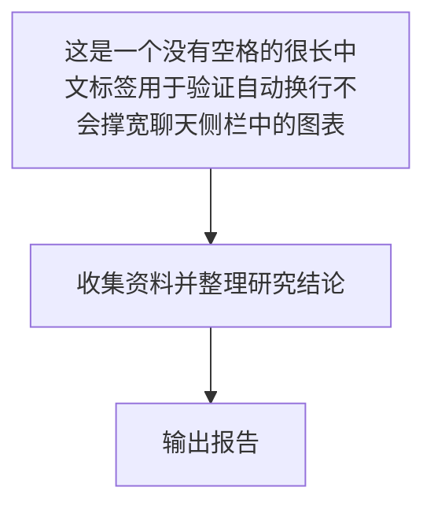
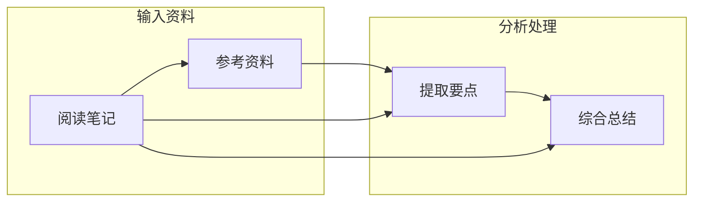
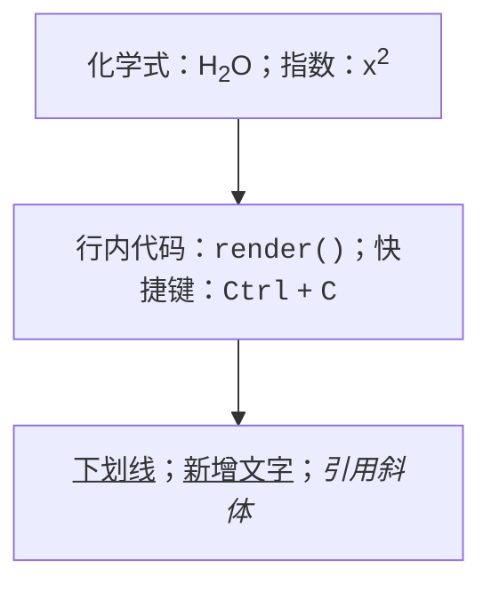

请进行 LUMEN 的 Pele 图表渲染测试。

仅在聊天中回复，将下面四段 Mermaid 代码块逐段原样输出，每段前加一个简短标题。不要在外面再加一层代码围栏，不要用图片替代图表。本次只测试文本图表，不需要调用工具、联网或读写笔记。

第一段：中文长标签换行。



第二段：跨子图连线。



第三段：中文桑基图与渐变。

```mermaid
sankey-beta
阅读时间,文献研究,50
阅读时间,实践案例,30
阅读时间,复盘整理,20
文献研究,最终报告,50
实践案例,最终报告,30
复盘整理,最终报告,20
```

第四段：上下标、代码、快捷键、下划线与引用斜体。


